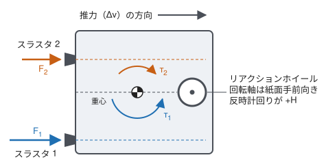

# 宇宙機モデル

[English](spacecraft-model.md) | **日本語**

このページでは，`spacecraft_ops_challenge.model` のリファレンス宇宙機モデル，
`spacecraft_ops_challenge.telemetry` のテレメトリ，`spacecraft_ops_challenge.modifiers` の `Modifier` について説明します。

このモデルは，意図的に小規模にとどめた簡易モデルです。
数値はすべてパラメータとして与えられ，モデル自体に固定値はありません。
単位はどのフィールド名にも接尾辞として含まれています。
`_s`（秒），`_mps`（m/s），`_mps2`（m/s²），`_c`（°C），`_w`（W），`_wh`（Wh），`_j_per_k`（J/K），`_w_per_k`（W/K），`_nms`（N·m·s）です。

## 状態

`SpacecraftState` は真の内部状態です。

| フィールド | 意味 |
|---|---|
| `time_s` | シミュレーション時刻 |
| `delta_v_mps` | 累積 Δv |
| `propulsion_temperature_c` | 推進系の温度 |
| `battery_energy_wh` | バッテリの蓄電量 |
| `wheel_momentum_nms` | ホイール角運動量（スカラ） |
| `heater_on` | ヒータの状態 |
| `propulsion_mode` | `OFF`，`THRUSTER_1`，`THRUSTER_2` のいずれか |

## パラメータ

`SpacecraftParameters` は，スラスタごとの `ThrusterParameters` と，宇宙機全体に関わるパラメータを保持します。

各スラスタは，加速度（Δv の変化率），電力負荷，推進系への入熱，符号付きのホイール角運動量変化率を持ちます。
2つのスラスタはそれぞれ独立に設定されます。
対称な構成では，ホイール角運動量変化率の符号が逆であることを除いて同じ値を使い，
`THRUSTER_1` がホイール角運動量を増やし，`THRUSTER_2` が減らすようにします。



この図は，2つのスラスタのずれと推力が異なる一般の場合について，ホイール角運動量変化率の背後にある物理的なイメージを示しています。
各スラスタの推力の作用線は重心からずれているため，噴射すると1軸まわりのトルクが生じ，それをリアクションホイールが吸収します。
トルクが1軸まわりであるため，ホイール角運動量はスカラであり，モデルの中でそれを変化させるのはスラスタだけです。
モデルはこのトルクを幾何から計算せず，その結果としての変化率を `wheel_momentum_rate_nms_per_s` として直接受け取ります。

`min_firing_temperature_c` は，選択されたスラスタが噴射できる推進系温度の下限です。

`SafetyLimits` は，推進系温度の上限，バッテリ蓄電量の下限，ホイール角運動量の絶対値の上限を定めます。

## ダイナミクス

`compute_rates(state, parameters)` は，状態の時間微分を `StateRates` として返します。
寄与するのは推進モードで選択されたスラスタだけで，それも推進系温度が `min_firing_temperature_c` 以上である間に限られます。
この温度を下回ると，選択されたスラスタは，推進がオフのときと同様に，加速度，電力負荷，推進系への入熱，ホイール角運動量変化率のいずれにも寄与しません。
推進モード自体は指令されたまま変わらないため，テレメトリは引き続きそのモードを示します。

Δv と角運動量は次のとおりです。

```text
d(delta_v)/dt = thruster acceleration
dH/dt         = thruster wheel-momentum rate
```

電力は次のとおりです。
ヒータとスラスタの負荷は，動作している間だけ計上します。

```text
P_net = power_generation - bus_load - heater_load - thruster_load
```

熱は，熱容量 `C`，熱コンダクタンス `G`，シンク温度 `T_sink` を持つ1節点の集中熱容量モデルで表します。

```text
C * dT/dt = heater_power + thruster_heat - G * (T - T_sink)
```

ヒータの消費電力は，すべて推進系の熱になります。

`integrate(state, rates, duration_s, parameters)` は，陽的オイラー法で状態を1ステップ進めます。
バッテリの蓄電量は，正味電力による変化をワット時に換算して更新され，バッテリ容量を超えた分は切り捨てられます。
ただし，0を下限とする制限はかけません。

## テレメトリ

`Telemetry` は，戦略が得られる観測です。
`SpacecraftState` と同じフィールドを持ちますが別の型であり，その値は真の状態と異なることがあります。
`nominal_telemetry(state)` は，真の状態を理想的に観測した結果を返します。

## `Modifier`

`Modifier` は，公称モデルを基準として，シミュレーションの振る舞いを変化させます。
次の3つのフックのいずれもオーバーライドでき，デフォルトでは何も変更しません。

| フック | 変更する対象 |
|---|---|
| `modify_parameters(parameters, state, rng)` | `state.time_s` における実効パラメータ |
| `modify_rates(rates, state, parameters, rng)` | 公称モデルで計算した後の状態の変化率 |
| `modify_telemetry(telemetry, state, rng)` | 戦略に渡す観測 |

フックは真の状態を受け取るため，時刻や状態に応じて効果を変えられます。
`Modifier` は順番に適用され，それぞれが直前の `Modifier` の結果を受け取ります。
`Modifier` は状態を持たないように作るべきです。
乱数はすべて，引数で渡される `random.Random`（シードで初期化済み）から得なければなりません。

`effective_parameters`，`effective_rates`，`observe` は，`Modifier` の列をまとめて適用します。

組み込みの `Modifier` は次のとおりです。

| `Modifier` | 効果 |
|---|---|
| `ThrusterEfficiency(thruster, factor, onset_time_s=0.0)` | `onset_time_s` 以降，1つのスラスタの加速度を `factor` 倍する |
| `TelemetryBias(channel, bias)` | 数値のテレメトリチャネル1つに定数を加える |
