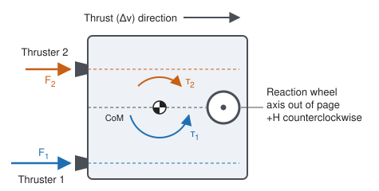

# Spacecraft Model

**English** | [日本語](spacecraft-model.ja.md)

This page describes the reference spacecraft model in `spacecraft_autonomy_challenge.model`,
telemetry in `spacecraft_autonomy_challenge.telemetry`, and modifiers in `spacecraft_autonomy_challenge.modifiers`.

The model is a deliberately small toy model.
All numbers are parameters; none are fixed by the model itself.
Units are part of every field name:
`_s` (seconds), `_mps` (meters per second), `_mps2` (meters per second squared), `_c` (degrees Celsius),
`_w` (watts), `_wh` (watt-hours), `_j_per_k` (joules per kelvin), `_w_per_k` (watts per kelvin), and `_nms` (newton-meter-seconds).

## State

`SpacecraftState` is the true internal state:

| Field | Meaning |
|---|---|
| `time_s` | Simulation time |
| `delta_v_mps` | Accumulated delta-v |
| `propulsion_temperature_c` | Temperature of the propulsion system |
| `battery_energy_wh` | Stored battery energy |
| `wheel_momentum_nms` | Scalar wheel momentum |
| `heater_on` | Heater state |
| `propulsion_mode` | `OFF`, `THRUSTER_1`, or `THRUSTER_2` |
| `momentum_dump_on` | Momentum dump state |

## Parameters

`SpacecraftParameters` holds one `ThrusterParameters` per thruster and the spacecraft-level parameters.

Each thruster has an acceleration (delta-v rate), an electrical load,
a heat input to the propulsion system, and a signed wheel-momentum rate.
Both thrusters are configured independently.
A symmetric configuration uses identical values except for opposite wheel-momentum rates,
so that `THRUSTER_1` increases and `THRUSTER_2` decreases the wheel momentum.



The figure shows the physical picture behind the wheel-momentum rate for the general case,
in which the two offsets and thrusts differ.
Each thruster's line of action is offset from the center of mass,
so firing it produces a torque about a single axis, which a reaction wheel absorbs.
Because the torque is about a single axis, the wheel momentum is a scalar,
and the thrusters and the momentum dump are the only parts of the model that change it.
The model does not compute this torque from geometry; it takes the resulting rate directly as `wheel_momentum_rate_nms_per_s`.

`min_firing_temperature_c` is the lowest propulsion temperature at which a selected thruster fires.

The momentum dump uses reaction control system (RCS) thrusters to unload the wheel.
`momentum_dump_rate_nms_per_s` is the rate at which it moves the wheel momentum toward zero,
and `momentum_dump_power_w` and `momentum_dump_heat_w` are its electrical load
and its heat input to the propulsion system at that rate.

`SafetyLimits` defines the maximum propulsion temperature, the minimum battery energy, and the maximum absolute wheel momentum.

## Dynamics

`compute_rates(state, parameters)` returns the time derivatives in `StateRates`.
Only the thruster selected by the propulsion mode contributes,
and only while the propulsion temperature is at or above `min_firing_temperature_c`.
Below that temperature the selected thruster contributes no acceleration, electrical load, heat, or wheel-momentum rate,
as if propulsion were off.
The same holds at any temperature while the momentum dump is on.
The propulsion mode itself stays as commanded, so telemetry still reports it.

`add_momentum_dump(state, rates, duration_s, parameters)` adds the momentum dump to the rates of one integration step
while the dump is on, and returns the rates unchanged otherwise.

Delta-v and momentum:

```text
d(delta_v)/dt = thruster acceleration
dH/dt         = thruster wheel-momentum rate + dump wheel-momentum rate
```

Power, with heater, thruster, and dump loads counted only while active:

```text
P_net = power_generation - bus_load - heater_load - thruster_load - dump_load
```

Thermal, as a single lumped node with heat capacity `C`, conductance `G`, and sink temperature `T_sink`:

```text
C * dT/dt = heater_power + thruster_heat + dump_heat - G * (T - T_sink)
```

All heater electrical power becomes heat in the propulsion system.

`integrate(state, rates, duration_s, parameters)` advances the state by one explicit Euler step.
Battery energy is converted from watts to watt-hours and capped at the battery capacity.
It is not clamped at zero.

### Momentum Dump

While the dump is on, its wheel-momentum rate in an integration step is the one,
at most `momentum_dump_rate_nms_per_s` in magnitude,
that brings the wheel momentum closest to zero at the end of the step,
together with the wheel-momentum rate from the rest of the model and the modifiers.
The dump therefore moves the wheel momentum toward zero at its full rate and does not move it past zero.
Its electrical load and heat are `momentum_dump_power_w` and `momentum_dump_heat_w`,
scaled by the fraction of the full rate that it uses in the step.

When the wheel momentum is zero at the end of an integration step while the dump is on,
`integrate` sets it to exactly zero and switches the dump off:
`momentum_dump_on` becomes `False`, and the selected thruster contributes again from then on.
The wheel momentum counts as zero within `WHEEL_MOMENTUM_ZERO_NMS` (`1e-9` Nms).
A dump switched on at zero wheel momentum therefore switches itself off at the end of the next integration step,
if nothing else moves the wheel.

The model of the dump is simplified:
it produces no net force and so no delta-v,
it uses no propellant (like the main thrusters, whose propellant is not modeled either),
and it has no minimum operating temperature.

## Telemetry

`Telemetry` is the observation available to a strategy.
It has the same fields as `SpacecraftState` but is a separate type, and its values may differ from the true state.
`nominal_telemetry(state)` returns an ideal observation of the true state.

## Modifiers

A `Modifier` changes the behavior of a run relative to the nominal model.
It can override any of three hooks; the defaults change nothing:

| Hook | Changes |
|---|---|
| `modify_parameters(parameters, state, rng)` | The effective parameters at `state.time_s` |
| `modify_rates(rates, state, parameters, rng)` | The state rates after the nominal model, before the momentum dump is added |
| `modify_telemetry(telemetry, state, rng)` | The observation given to a strategy |

Hooks receive the true state, so effects can depend on time or on the state.
Modifiers are applied in order, each receiving the result of the previous one.
They should be stateless and must take any randomness from the provided seeded `random.Random`.

`effective_parameters`, `effective_rates`, and `observe` apply a sequence of modifiers.

Built-in modifiers:

| Modifier | Effect |
|---|---|
| `ThrusterEfficiency(thruster, factor, onset_time_s=0.0)` | From `onset_time_s` onward, scales one thruster's acceleration and wheel-momentum rate by `factor`; its electrical load and heat are unchanged |
| `ThrusterFlow(thruster, factor, onset_time_s=0.0)` | From `onset_time_s` onward, scales one thruster's acceleration, wheel-momentum rate, and heat by `factor`; its electrical load is unchanged |
| `TelemetryBias(channel, bias)` | Adds a constant to one numeric telemetry channel |

`ThrusterEfficiency` models a thruster that fires at a lower efficiency,
and `ThrusterFlow` a thruster with a reduced propellant flow.
With `factor=0`, a thruster under `ThrusterFlow` produces no acceleration, wheel-momentum rate, or heat,
but still draws its electrical load while it is selected.
Both take `thruster` as `THRUSTER_1` or `THRUSTER_2` (a member or its name) and reject a negative `factor`.
